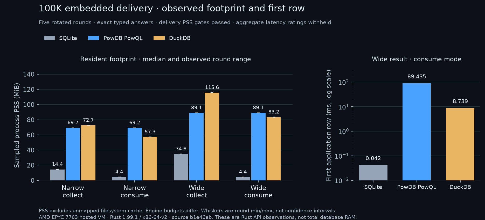

# Hosted 100K relational-read baseline: 2026-11-06

Both 100K collections completed without worker failures. Registered native query checks pass; aggregate latency ratings remain withheld on timing noise. The embedded four-case delivery PSS index passes its fixed evidence gates. This is a fixed read-profile baseline of PowDB 0.29.2, SQLite 3.54.1, DuckDB 2.0.0, PostgreSQL 18.6 and MySQL 8.4.13 LTS through Rust client APIs. It is not a universal engine ranking. Unsupported cases, incorrect answers, missing evidence and noise failures remain visible. No operational or security-strength score follows from these read tests.

Full methodology: [cross-engine baseline](competitive-baseline.md). Documented controls and unmeasured axes: [capability evidence](competitive-capabilities.md).

## Provenance

- [Complete hosted run and build logs](https://github.com/ZVN-DEV/powdb/actions/runs/42335462726).
- Harness source: `b1e46ebc333f068f1bff71e350a28b32e28c12d2`; production query/storage/server/auth source matches tag v0.29.2.
- Rust 1.99.1 with `-C target-cpu=x86-64-v2`; SQLite uses the verified private C build, DuckDB the verified upstream release library, servers the digest-pinned images.
- Each cohort has its own hosted VM. Engine comparisons within a cohort use the same VM and fixture. Never compare absolute embedded/server numbers as if transport and hardware were equal.
- A query CPU is pinned separately from the controller. The host can still have invisible tenant contention; the fixed qualification gates remain necessary.
- Full raw samples and summaries accompany this record; archive and decoded-content hashes appear below.

## Reading the tables

The sampled-PSS index is `100 * geometric_mean(smallest_case_PSS / engine_case_PSS)` across all four registered embedded delivery modes. Higher means lower observed resident PSS in this fixed profile; it is not a percentage grade. Small differences between PowDB and DuckDB do not establish a winner.

All numeric latency cells are medians of round medians in **microseconds**. The tables retain diagnostic medians when timing gates fail; the final column identifies qualification for the native and SQL cohorts separately. `pass` means the individual case passed the fixed correctness, full-count, round-spread and identical-binary latency gates. `diagnostic` cases must not be ranked. `rejected` is a capability outcome.

Materialized and consume modes have different boundaries. Materialization returns the complete application collection; consumption visits a bounded checksum sink. PowDB still materializes the engine result/native wire frame before visiting rows. This profile does not measure slow-consumer backpressure, durable writes, mixed concurrency, recovery or security attacks.

## Embedded results

Host CPU: **AMD EPYC 7763 64-Core Processor**. Fixture: 100,000 rows; 5 rotated rounds.

| Case / delivery | sqlite | powdb-powql | powdb-sql | duckdb | Native / SQL qualification |
| --- | ---: | ---: | ---: | ---: | --- |
| point_bound / materialized | 4.689 | 5.981 | rejected | 428.524 | pass / diagnostic |
| point_indexed / materialized | 7.084 | 7.434 | 12.709 | 856.726 | pass / pass |
| point_missing / materialized | 4.769 | 2.485 | 6.251 | 749.806 | pass / pass |
| point_unindexed / materialized | 8,540.215 | 3,622.439 | 3,871.978 | 2,177.383 | diagnostic / diagnostic |
| range_page / materialized | 12.659 | 160,488.946 | 162,590.340 | 1,944.642 | diagnostic / diagnostic |
| filtered_count / materialized | 7,315.359 | 3,015.380 | 2,996.814 | 1,041.561 | pass / pass |
| and_projection / materialized | 232.947 | 3,755.473 | 3,617.568 | 1,632.266 | pass / pass |
| or_projection / materialized | 205.310 | 20,223.968 | 20,433.277 | 3,565.356 | pass / pass |
| indexed_in / materialized | 62.532 | 1,060.765 | rejected | 1,583.140 | pass / diagnostic |
| unindexed_in / materialized | 9,153.644 | 3,912.969 | rejected | 1,677.084 | diagnostic / diagnostic |
| unindexed_not_in / materialized | 13,015.911 | 3,829.874 | rejected | 1,235.607 | diagnostic / diagnostic |
| null_count / materialized | 7,454.060 | 3,127.636 | 2,777.087 | 891.287 | diagnostic / diagnostic |
| sort_top100 / materialized | 8,881.199 | 42,490.336 | 46,139.943 | 1,881.123 | diagnostic / diagnostic |
| pagination_offset / materialized | 57,687.440 | 140,823.144 | 134,409.877 | 7,446.957 | pass / pass |
| pagination_keyset / materialized | 8,841.476 | 36,625.033 | 36,364.462 | 2,702.928 | diagnostic / diagnostic |
| pagination_pk_offset / materialized | 3,741.752 | 79,289.080 | 78,879.303 | 2,756.329 | pass / pass |
| pagination_pk_keyset / materialized | 20.479 | 63,470.800 | 63,737.030 | 1,231.700 | pass / pass |
| sum / materialized | 7,640.342 | 2,951.755 | 3,206.100 | 852.333 | pass / pass |
| avg / materialized | 7,721.345 | 3,002.372 | 3,097.296 | 993.641 | pass / pass |
| group_having / materialized | 34,903.639 | 89,051.757 | 85,438.418 | 2,362.910 | pass / pass |
| distinct / materialized | 29,894.188 | 118,406.719 | 118,958.781 | 1,585.639 | pass / pass |
| join_projection / materialized | 442.695 | 131,701.327 | 130,030.296 | 2,234.997 | diagnostic / diagnostic |
| compound_join / materialized | 51.877 | 133,664.108 | 130,747.903 | 2,413.361 | diagnostic / diagnostic |
| join_group_having / materialized | 40,064.497 | 172,864.564 | 140,232.267 | 3,229.456 | pass / pass |
| exists_correlated / materialized | 126.497 | 755,146.868 | rejected | 2,194.195 | diagnostic / diagnostic |
| in_subquery / materialized | 141.701 | 6,171.320 | rejected | 1,983.554 | pass / diagnostic |
| case_expression / materialized | 25.003 | 344.030 | rejected | 1,284.013 | pass / diagnostic |
| int64_exact / materialized | 4.779 | 6.362 | 10.239 | 752.391 | diagnostic / diagnostic |
| window_rank / materialized | 95.945 | 361.140 | rejected | 2,613.965 | pass / diagnostic |
| all_rows_narrow / materialized | 16,261.741 | 103,412.575 | 103,488.811 | 18,060.610 | pass / pass |
| all_rows_narrow / consume | 23,943.625 | 111,457.253 | 110,860.018 | 15,445.265 | pass / pass |
| all_rows_wide / materialized | 28,971.518 | 96,763.812 | 99,615.014 | 36,720.605 | pass / pass |
| all_rows_wide / consume | 70,661.671 | 141,760.027 | 141,685.847 | 63,610.936 | pass / pass |

| Cohort | Correct workload/delivery checks | Aggregate latency score | Sampled delivery PSS score |
| --- | --- | --- | --- |
| native: sqlite | 33 / 33 | withheld | 100.00 |
| native: duckdb | 33 / 33 | withheld | 12.44 |
| native: powdb-powql | 33 / 33 | withheld | 12.61 |

Native latency reasons: a common workload failed identical-binary A/A calibration; a common workload failed request-count or stability gates.
Native memory reasons: none.

| sql: sqlite | 33 / 33 | withheld | 100.00 |
| sql: duckdb | 33 / 33 | withheld | 12.44 |
| sql: powdb-sql | 25 / 33 | withheld | 12.59 |

Sql latency reasons: a common workload failed identical-binary A/A calibration; a common workload failed request-count or stability gates.
Sql memory reasons: none.

### Delivery memory and first available application row

PSS is sampled resident memory in KiB, not total RAM or a guaranteed allocation peak. `unknown` means that valid evidence requirements were not met. First-row latency is microseconds and is measured at complete application availability for materialization. Each delivery mode reopens its client/embedded engine before its own warmup. Server buffers remain resident.

| Engine / case / mode | Sampled peak PSS (KiB) | First row (microseconds) |
| --- | ---: | ---: |
| sqlite / all_rows_narrow / materialized | 14,710 | 16,261.741 |
| sqlite / all_rows_narrow / consume | 4,494 | 19.456 |
| sqlite / all_rows_wide / materialized | 35,602 | 28,971.518 |
| sqlite / all_rows_wide / consume | 4,486 | 42.109 |
| powdb-powql / all_rows_narrow / materialized | 70,853 | 103,412.575 |
| powdb-powql / all_rows_narrow / consume | 70,834 | 98,701.273 |
| powdb-powql / all_rows_wide / materialized | 91,192 | 96,763.812 |
| powdb-powql / all_rows_wide / consume | 91,212 | 89,434.823 |
| powdb-sql / all_rows_narrow / materialized | 71,010 | 103,488.811 |
| powdb-sql / all_rows_narrow / consume | 71,040 | 98,031.909 |
| powdb-sql / all_rows_wide / materialized | 91,324 | 99,615.014 |
| powdb-sql / all_rows_wide / consume | 91,325 | 89,657.516 |
| duckdb / all_rows_narrow / materialized | 74,403 | 18,060.610 |
| duckdb / all_rows_narrow / consume | 58,639 | 3,327.309 |
| duckdb / all_rows_wide / materialized | 118,391 | 36,720.605 |
| duckdb / all_rows_wide / consume | 85,224 | 8,739.046 |

## Server results

Host CPU: **Intel(R) Xeon(R) Platinum 8370C CPU @ 2.80GHz**. Fixture: 100,000 rows; 6 rotated rounds.

| Case / delivery | postgres | mysql | powdb-server | powdb-server-sql | Native / SQL qualification |
| --- | ---: | ---: | ---: | ---: | --- |
| point_bound / materialized | 19.575 | 22.030 | 32.943 | rejected | pass / diagnostic |
| point_indexed / materialized | 68.532 | 29.176 | 33.768 | 38.994 | pass / pass |
| point_missing / materialized | 61.855 | 24.029 | 30.591 | 32.332 | pass / pass |
| point_unindexed / materialized | 9,083.797 | 35,896.450 | 2,446.340 | 2,945.668 | diagnostic / diagnostic |
| range_page / materialized | 90.570 | 447.691 | 35,123.523 | 32,932.842 | diagnostic / diagnostic |
| filtered_count / materialized | 7,819.922 | 11,465.802 | 1,790.965 | 1,734.796 | diagnostic / diagnostic |
| and_projection / materialized | 735.878 | 2,035.181 | 2,981.789 | 2,699.267 | diagnostic / diagnostic |
| or_projection / materialized | 599.176 | 1,557.044 | 16,374.174 | 16,079.485 | pass / pass |
| indexed_in / materialized | 262.928 | 182.596 | 317.249 | rejected | pass / diagnostic |
| unindexed_in / materialized | 10,395.222 | 13,336.437 | 2,911.211 | rejected | diagnostic / diagnostic |
| unindexed_not_in / materialized | 11,765.032 | 12,615.842 | 2,569.073 | rejected | diagnostic / diagnostic |
| null_count / materialized | 8,570.294 | 10,726.257 | 1,968.928 | 1,765.605 | diagnostic / diagnostic |
| sort_top100 / materialized | 12,156.922 | 16,826.043 | 50,090.567 | 50,111.897 | pass / pass |
| pagination_offset / materialized | 40,961.556 | 27,748.048 | 127,373.271 | 127,342.002 | pass / pass |
| pagination_keyset / materialized | 10,589.073 | 16,220.381 | 36,379.772 | 36,279.800 | pass / pass |
| pagination_pk_offset / materialized | 9,562.562 | 9,981.778 | 66,667.248 | 66,681.384 | pass / pass |
| pagination_pk_keyset / materialized | 121.126 | 422.005 | 11,148.791 | 10,948.294 | diagnostic / diagnostic |
| sum / materialized | 8,596.279 | 13,788.564 | 1,810.719 | 1,753.360 | diagnostic / diagnostic |
| avg / materialized | 8,550.890 | 13,904.531 | 1,937.660 | 1,717.696 | diagnostic / diagnostic |
| group_having / materialized | 15,811.265 | 34,573.075 | 66,717.944 | 63,996.317 | pass / pass |
| distinct / materialized | 12,901.248 | 20,876.409 | 116,723.326 | 117,795.887 | pass / pass |
| join_projection / materialized | 1,422.753 | 2,170.922 | 120,945.909 | 124,369.086 | diagnostic / pass |
| compound_join / materialized | 369.699 | 318.804 | 120,740.377 | 123,675.197 | diagnostic / diagnostic |
| join_group_having / materialized | 22,421.984 | 101,921.470 | 178,916.741 | 138,709.866 | pass / pass |
| exists_correlated / materialized | 748.295 | 491.839 | 409,095.412 | rejected | pass / diagnostic |
| in_subquery / materialized | 748.383 | 488.083 | 7,190.229 | rejected | diagnostic / diagnostic |
| case_expression / materialized | 170.136 | 86.075 | 155.594 | rejected | diagnostic / diagnostic |
| int64_exact / materialized | 77.367 | 25.748 | 36.247 | 40.605 | diagnostic / diagnostic |
| window_rank / materialized | 191.582 | 153.986 | 185.103 | rejected | diagnostic / diagnostic |
| all_rows_narrow / materialized | 56,624.827 | 33,891.427 | 90,827.314 | 90,168.052 | pass / pass |
| all_rows_narrow / consume | 62,588.306 | 40,570.251 | 94,296.338 | 97,785.402 | pass / pass |
| all_rows_wide / materialized | 72,381.787 | 70,245.652 | 136,057.960 | 142,331.403 | pass / pass |
| all_rows_wide / consume | 99,739.838 | 96,298.876 | 171,604.211 | 179,900.557 | pass / pass |

| Cohort | Correct workload/delivery checks | Aggregate latency score | Sampled delivery PSS score |
| --- | --- | --- | --- |
| native: postgres | 33 / 33 | withheld | withheld |
| native: mysql | 33 / 33 | withheld | withheld |
| native: powdb-server | 33 / 33 | withheld | withheld |

Native latency reasons: a common workload failed request-count or stability gates.
Native memory reasons: missing/incorrect delivery observations or sampled PSS A/A differs by more than 20%.

| sql: postgres | 33 / 33 | withheld | withheld |
| sql: mysql | 33 / 33 | withheld | withheld |
| sql: powdb-server-sql | 25 / 33 | withheld | withheld |

Sql latency reasons: a common workload failed request-count or stability gates.
Sql memory reasons: missing/incorrect delivery observations or sampled PSS A/A differs by more than 20%.

### Delivery memory and first available application row

PSS is sampled resident memory in KiB, not total RAM or a guaranteed allocation peak. `unknown` means that valid evidence requirements were not met. First-row latency is microseconds and is measured at complete application availability for materialization. Each delivery mode reopens its client/embedded engine before its own warmup. Server buffers remain resident.

| Engine / case / mode | Sampled peak PSS (KiB) | First row (microseconds) |
| --- | ---: | ---: |
| postgres / all_rows_narrow / materialized | 98,470 | 56,624.827 |
| postgres / all_rows_narrow / consume | 75,728 | 21,128.832 |
| postgres / all_rows_wide / materialized | 108,948 | 72,381.787 |
| postgres / all_rows_wide / consume | 69,490 | 338.089 |
| mysql / all_rows_narrow / materialized | 521,733 | 33,891.427 |
| mysql / all_rows_narrow / consume | 511,867 | 2,539.863 |
| mysql / all_rows_wide / materialized | 542,712 | 70,245.652 |
| mysql / all_rows_wide / consume | 511,831 | 818.268 |
| powdb-server / all_rows_narrow / materialized | 374,193 | 90,827.314 |
| powdb-server / all_rows_narrow / consume | 371,845 | 83,392.321 |
| powdb-server / all_rows_wide / materialized | 476,191 | 136,057.960 |
| powdb-server / all_rows_wide / consume | 476,161 | 124,096.442 |
| powdb-server-sql / all_rows_narrow / materialized | 394,667 | 90,168.052 |
| powdb-server-sql / all_rows_narrow / consume | 392,365 | 86,953.636 |
| powdb-server-sql / all_rows_wide / materialized | 500,789 | 142,331.403 |
| powdb-server-sql / all_rows_wide / consume | 497,285 | 131,144.473 |

## Interpretation and limits

Equivalent results establish correctness only for these fixtures and query mappings. PowDB SQL rejects bound preparation, IN-list/subquery, EXISTS, CASE and window probes despite native PowQL support. Exact int64 results, including values above JavaScript safe integer range, are checked without converting integers through floating point.

Latency ratings cannot be rebuilt on a hand-selected passing subset. Both complete 100K collections have no worker failures and all native query results match the oracle. Noise still withholds aggregate latency ratings. The [earlier 10K record](2026-11-06-competitive-reads.md) retains its PostgreSQL-A/A startup failures and original qualification outcome. No observations from separate runs are spliced together. Different runner CPUs prevent treating the 10K and 100K records as a controlled size-versus-latency experiment.

The sampled PSS index is a workload-specific relative index, not a memory-efficiency percentage. SQLite is 100; PowQL is about 12.61 and DuckDB about 12.44 across four embedded delivery cases. The small PowQL/DuckDB difference does not establish a winner. PSS omits unmapped filesystem cache, so it does not rank total database RAM use. Defaults differ, including DuckDB memory_limit 12.4 GiB and PowDB query allowance 256 MiB; equal-budget behavior is unmeasured. Owned servers keep buffers and allocator state from fixture loading. Their PSS is post-ingest resident footprint, not query-attributed allocation. Read timings do not establish crash safety.

No security-strength ranking is assigned. The separate documented server-control profile covers named authentication, TLS, table grants and column grants; behavioral adversarial tests remain unmeasured.

## Statistics and configuration boundary

The fixture code does not explicitly request ANALYZE/optimizer-statistics maintenance, and background maintenance stays at engine defaults. These observations are a fresh-load/default-configuration profile, not a comparison of each engine at its best tuning. A separate statistics-controlled profile must not overwrite this evidence. [PostgreSQL ANALYZE](https://www.postgresql.org/docs/18/sql-analyze.html), [SQLite ANALYZE/optimize](https://www.sqlite.org/lang_analyze.html) and [MySQL ANALYZE TABLE](https://dev.mysql.com/doc/refman/8.4/en/analyze-table.html) document the role of statistics.

## Raw evidence and replay

| File | SHA-256 of stored file | SHA-256 after decoding |
| --- | --- | --- |
| [2026-11-06-competitive-100k-embedded-observations.json.gz](2026-11-06-competitive-100k-embedded-observations.json.gz) | `b3ce3490a9d768108e1570e842f8897b4fc92efb3f78ac89eb0660bc353f40e8` | `5390f48f2c0f244d8e6670de3f3fde172693c31bdc87adbc43d7aef0f0536f04` |
| [2026-11-06-competitive-100k-embedded-scorecard.json](2026-11-06-competitive-100k-embedded-scorecard.json) | `e0dd9e4020c177c4f5df3403df8b91b406ffa737a5649731db4e5c9b87f55950` | `e0dd9e4020c177c4f5df3403df8b91b406ffa737a5649731db4e5c9b87f55950` |
| [2026-11-06-competitive-100k-embedded-build-manifest.json](2026-11-06-competitive-100k-embedded-build-manifest.json) | `03d75048308ece9734dd81ec89657b54fb771bd07230113e78baf6292d051556` | `03d75048308ece9734dd81ec89657b54fb771bd07230113e78baf6292d051556` |
| [2026-11-06-competitive-100k-server-observations.json.gz](2026-11-06-competitive-100k-server-observations.json.gz) | `1f20270210a82c095ee3b8ae85082ffb6fdf608231e70c2612dbf78f1b12a287` | `cd29f913f85515a3fb69117e8368bd8ba94e02304f28aec9e0860652f343c253` |
| [2026-11-06-competitive-100k-server-scorecard.json](2026-11-06-competitive-100k-server-scorecard.json) | `a06921368c38f622030286199c4355fb6335180ff5882efa155baf7816ec7f1a` | `a06921368c38f622030286199c4355fb6335180ff5882efa155baf7816ec7f1a` |
| [2026-11-06-competitive-100k-server-build-manifest.json](2026-11-06-competitive-100k-server-build-manifest.json) | `03d75048308ece9734dd81ec89657b54fb771bd07230113e78baf6292d051556` | `03d75048308ece9734dd81ec89657b54fb771bd07230113e78baf6292d051556` |
| [2026-11-06-competitive-100k-server-server-smoke.json](2026-11-06-competitive-100k-server-server-smoke.json) | `9b18a02174ca503d1c124e8d0f2af4e0fb55634717750497f4431feda1313d0f` | `9b18a02174ca503d1c124e8d0f2af4e0fb55634717750497f4431feda1313d0f` |

To rescore, decompress the observations and run `scripts/competitive/score.py` from the exact harness source above. Its catalog hash deliberately refuses a different workload catalog. Compiler output and loaded-library/feature trees remain in the linked Actions artifacts.
