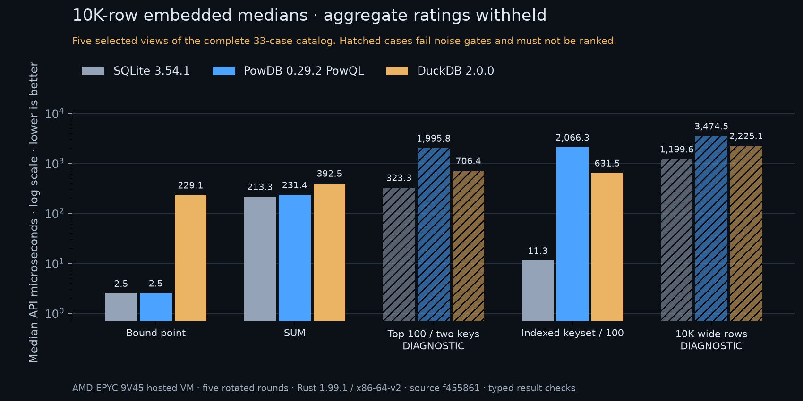

# Hosted relational-read baseline: 2026-11-06

This is a fixed read-profile baseline of PowDB 0.29.2, SQLite 3.54.1, DuckDB 2.0.0, PostgreSQL 18.6 and MySQL 8.4.13 LTS through Rust client APIs. It is not a universal engine ranking. Unsupported cases, incorrect answers, missing evidence and noise failures remain visible. No operational or security-strength score follows from these read tests.

Full methodology: [cross-engine baseline](competitive-baseline.md). Documented controls and unmeasured axes: [capability evidence](competitive-capabilities.md).

## Provenance

- [Complete hosted run and build logs](https://github.com/ZVN-DEV/powdb/actions/runs/42334103067).
- Harness source: `f4558611b4c172cd5112b1f6343f10130d038f61`; production query/storage/server/auth source matches tag v0.29.2.
- Rust 1.99.1 with `-C target-cpu=x86-64-v2`; SQLite uses the verified private C build, DuckDB the verified upstream release library, servers the digest-pinned images.
- Each cohort has its own hosted VM. Engine comparisons within a cohort use the same VM and fixture. Never compare absolute embedded/server numbers as if transport and hardware were equal.
- A query CPU is pinned separately from the controller. The host can still have invisible tenant contention; the fixed qualification gates remain necessary.
- Full raw samples and summaries accompany this record; archive and decoded-content hashes appear below.

## Reading the tables

All numeric latency cells are medians of round medians in **microseconds**. The tables retain diagnostic medians when timing gates fail; the final column identifies qualification for the native and SQL cohorts separately. `pass` means the individual case passed the fixed correctness, full-count, round-spread and identical-binary latency gates. `diagnostic` cases must not be ranked. `rejected` is a capability outcome.

Materialized and consume modes have different boundaries. Materialization returns the complete application collection; consumption visits a bounded checksum sink. PowDB still materializes the engine result/native wire frame before visiting rows. This profile does not measure slow-consumer backpressure, durable writes, mixed concurrency, recovery or security attacks.

## Embedded results

Host CPU: **AMD EPYC 9V45 96-Core Processor**. Fixture: 10,000 rows; 5 rotated rounds.

| Case / delivery | sqlite | powdb-powql | powdb-sql | duckdb | Native / SQL qualification |
| --- | ---: | ---: | ---: | ---: | --- |
| point_bound / materialized | 2.474 | 2.503 | rejected | 229.139 | pass / diagnostic |
| point_indexed / materialized | 3.776 | 3.405 | 6.209 | 491.220 | pass / pass |
| point_missing / materialized | 3.185 | 1.332 | 3.375 | 374.909 | pass / pass |
| point_unindexed / materialized | 251.208 | 271.808 | 274.453 | 567.177 | pass / pass |
| range_page / materialized | 6.840 | 5,266.541 | 5,359.779 | 1,050.548 | diagnostic / diagnostic |
| filtered_count / materialized | 209.685 | 237.232 | 242.449 | 511.659 | pass / pass |
| and_projection / materialized | 124.433 | 288.393 | 293.075 | 762.605 | diagnostic / diagnostic |
| or_projection / materialized | 103.671 | 1,056.700 | 1,064.024 | 814.804 | pass / pass |
| indexed_in / materialized | 8.187 | 45.618 | rejected | 708.299 | pass / diagnostic |
| unindexed_in / materialized | 280.627 | 263.821 | rejected | 707.784 | pass / diagnostic |
| unindexed_not_in / materialized | 477.332 | 259.610 | rejected | 532.633 | pass / diagnostic |
| null_count / materialized | 231.478 | 239.295 | 242.825 | 429.822 | diagnostic / diagnostic |
| sort_top100 / materialized | 323.293 | 1,995.793 | 2,015.744 | 706.370 | diagnostic / diagnostic |
| pagination_offset / materialized | 2,345.282 | 3,757.860 | 3,762.091 | 842.405 | pass / pass |
| pagination_keyset / materialized | 326.962 | 1,683.468 | 1,686.312 | 970.938 | pass / pass |
| pagination_pk_offset / materialized | 50.626 | 2,658.613 | 2,673.626 | 698.107 | pass / pass |
| pagination_pk_keyset / materialized | 11.262 | 2,066.289 | 2,058.090 | 631.504 | pass / pass |
| sum / materialized | 213.321 | 231.387 | 233.968 | 392.454 | pass / pass |
| avg / materialized | 215.545 | 230.467 | 231.679 | 506.729 | pass / pass |
| group_having / materialized | 918.525 | 2,872.510 | 2,831.579 | 1,081.180 | pass / pass |
| distinct / materialized | 696.811 | 3,857.733 | 3,866.028 | 620.467 | pass / pass |
| join_projection / materialized | 219.266 | 5,380.314 | 5,507.614 | 1,156.661 | diagnostic / diagnostic |
| compound_join / materialized | 26.475 | 5,418.025 | 5,426.807 | 1,228.815 | pass / pass |
| join_group_having / materialized | 1,096.532 | 8,048.513 | 6,115.279 | 1,602.411 | pass / pass |
| exists_correlated / materialized | 63.670 | 33,893.162 | rejected | 1,247.573 | pass / diagnostic |
| in_subquery / materialized | 64.647 | 372.240 | rejected | 1,091.142 | pass / diagnostic |
| case_expression / materialized | 11.924 | 118.848 | rejected | 810.899 | pass / diagnostic |
| int64_exact / materialized | 3.125 | 2.884 | 5.133 | 417.352 | pass / pass |
| window_rank / materialized | 44.067 | 125.479 | rejected | 1,419.235 | pass / diagnostic |
| all_rows_narrow / materialized | 638.870 | 3,411.505 | 3,414.881 | 1,433.792 | diagnostic / diagnostic |
| all_rows_narrow / consume | 1,098.540 | 4,025.856 | 4,014.298 | 1,557.057 | diagnostic / diagnostic |
| all_rows_wide / materialized | 1,199.592 | 3,474.490 | 3,454.771 | 2,225.103 | diagnostic / diagnostic |
| all_rows_wide / consume | 4,093.850 | 6,653.005 | 6,726.391 | 5,225.368 | diagnostic / diagnostic |

| Cohort | Correct workload/delivery checks | Aggregate latency score | Sampled delivery PSS score |
| --- | --- | --- | --- |
| native: sqlite | 33 / 33 | withheld | withheld |
| native: duckdb | 33 / 33 | withheld | withheld |
| native: powdb-powql | 33 / 33 | withheld | withheld |

Native latency reasons: a common workload failed identical-binary A/A calibration; a common workload failed request-count or stability gates.
Native memory reasons: missing/incorrect delivery observations or sampled PSS A/A differs by more than 20%.

| sql: sqlite | 33 / 33 | withheld | withheld |
| sql: duckdb | 33 / 33 | withheld | withheld |
| sql: powdb-sql | 25 / 33 | withheld | withheld |

SQL latency reasons: a common workload failed identical-binary A/A calibration; a common workload failed request-count or stability gates.
SQL memory reasons: missing/incorrect delivery observations or sampled PSS A/A differs by more than 20%.

### Delivery memory and first available application row

PSS is sampled resident memory in KiB, not total RAM or a guaranteed allocation peak. `unknown` means that valid evidence requirements were not met. First-row latency is microseconds and is measured at complete application availability for materialization. Each delivery mode reopens its client/embedded engine before its own warmup. Server buffers remain resident.

| Engine / case / mode | Sampled peak PSS (KiB) | First row (microseconds) |
| --- | ---: | ---: |
| sqlite / all_rows_narrow / materialized | unknown | 638.870 |
| sqlite / all_rows_narrow / consume | unknown | 4.767 |
| sqlite / all_rows_wide / materialized | 7,183 | 1,199.592 |
| sqlite / all_rows_wide / consume | 4,095 | 5.278 |
| powdb-powql / all_rows_narrow / materialized | 8,646 | 3,411.505 |
| powdb-powql / all_rows_narrow / consume | 8,684 | 3,243.443 |
| powdb-powql / all_rows_wide / materialized | 11,532 | 3,474.490 |
| powdb-powql / all_rows_wide / consume | 11,535 | 3,124.654 |
| powdb-sql / all_rows_narrow / materialized | 8,765 | 3,414.881 |
| powdb-sql / all_rows_narrow / consume | 8,732 | 3,217.226 |
| powdb-sql / all_rows_wide / materialized | 11,689 | 3,454.771 |
| powdb-sql / all_rows_wide / consume | 11,684 | 3,220.248 |
| duckdb / all_rows_narrow / materialized | unknown | 1,433.792 |
| duckdb / all_rows_narrow / consume | unknown | 704.427 |
| duckdb / all_rows_wide / materialized | 60,746 | 2,225.103 |
| duckdb / all_rows_wide / consume | 57,822 | 1,216.784 |

## Server results

Host CPU: **AMD EPYC 9V45 96-Core Processor**. Fixture: 10,000 rows; 6 rotated rounds.

| Case / delivery | postgres | mysql | powdb-server | powdb-server-sql | Native / SQL qualification |
| --- | ---: | ---: | ---: | ---: | --- |
| point_bound / materialized | 15.819 | 16.820 | 38.553 | rejected | diagnostic / diagnostic |
| point_indexed / materialized | 47.782 | 19.304 | 39.106 | 40.867 | diagnostic / diagnostic |
| point_missing / materialized | 45.581 | 17.537 | 38.866 | 39.237 | diagnostic / diagnostic |
| point_unindexed / materialized | 447.684 | 2,034.548 | 153.919 | 152.946 | diagnostic / diagnostic |
| range_page / materialized | 62.464 | 53.583 | 1,782.709 | 1,534.707 | diagnostic / diagnostic |
| filtered_count / materialized | 387.096 | 618.762 | 115.805 | 118.579 | diagnostic / diagnostic |
| and_projection / materialized | 427.271 | 1,159.629 | 184.478 | 193.114 | diagnostic / diagnostic |
| or_projection / materialized | 341.887 | 876.837 | 964.869 | 966.256 | diagnostic / diagnostic |
| indexed_in / materialized | 65.494 | 33.010 | 63.373 | rejected | diagnostic / diagnostic |
| unindexed_in / materialized | 511.618 | 697.034 | 155.967 | rejected | diagnostic / diagnostic |
| unindexed_not_in / materialized | 595.639 | 661.462 | 140.804 | rejected | diagnostic / diagnostic |
| null_count / materialized | 410.814 | 572.212 | 116.137 | 120.259 | diagnostic / diagnostic |
| sort_top100 / materialized | 631.899 | 974.879 | 1,625.392 | 1,565.469 | diagnostic / diagnostic |
| pagination_offset / materialized | 1,865.925 | 1,535.122 | 3,955.160 | 4,169.947 | diagnostic / diagnostic |
| pagination_keyset / materialized | 550.116 | 901.568 | 1,698.676 | 1,739.108 | diagnostic / diagnostic |
| pagination_pk_offset / materialized | 1,089.892 | 545.875 | 2,947.795 | 3,112.259 | diagnostic / diagnostic |
| pagination_pk_keyset / materialized | 78.583 | 60.542 | 518.393 | 527.230 | diagnostic / diagnostic |
| sum / materialized | 400.127 | 717.529 | 105.356 | 111.475 | diagnostic / diagnostic |
| avg / materialized | 402.111 | 732.960 | 103.987 | 107.905 | diagnostic / diagnostic |
| group_having / materialized | 852.161 | 1,860.122 | 3,121.129 | 3,203.233 | diagnostic / diagnostic |
| distinct / materialized | 699.812 | 1,118.447 | 4,172.171 | 4,423.794 | diagnostic / diagnostic |
| join_projection / materialized | 714.510 | 895.751 | 6,975.185 | 7,160.088 | diagnostic / diagnostic |
| compound_join / materialized | 182.022 | 1,300.601 | 6,820.524 | 6,692.536 | diagnostic / diagnostic |
| join_group_having / materialized | 1,330.555 | 2,337.445 | 6,675.535 | 7,945.809 | diagnostic / diagnostic |
| exists_correlated / materialized | 393.057 | 902.674 | 24,112.577 | rejected | diagnostic / diagnostic |
| in_subquery / materialized | 391.903 | 863.144 | 273.124 | rejected | diagnostic / diagnostic |
| case_expression / materialized | 86.059 | 47.499 | 84.993 | rejected | diagnostic / diagnostic |
| int64_exact / materialized | 48.005 | 18.816 | 40.168 | 42.361 | diagnostic / diagnostic |
| window_rank / materialized | 109.453 | 72.101 | 93.924 | rejected | diagnostic / diagnostic |
| all_rows_narrow / materialized | 3,136.765 | 2,286.568 | 4,203.921 | 4,537.976 | diagnostic / diagnostic |
| all_rows_narrow / consume | 4,018.102 | 2,704.239 | 4,865.515 | 4,971.877 | diagnostic / diagnostic |
| all_rows_wide / materialized | 5,922.118 | 4,471.222 | 5,852.262 | 6,462.722 | diagnostic / diagnostic |
| all_rows_wide / consume | 8,914.620 | 7,649.791 | 9,207.580 | 9,280.999 | diagnostic / diagnostic |

| Cohort | Correct workload/delivery checks | Aggregate latency score | Sampled delivery PSS score |
| --- | --- | --- | --- |
| native: postgres | 33 / 33 | withheld | withheld |
| native: mysql | 33 / 33 | withheld | withheld |
| native: powdb-server | 33 / 33 | withheld | withheld |

Native latency reasons: a common workload failed identical-binary A/A calibration; a common workload failed request-count or stability gates; worker/server failures occurred.
Native memory reasons: missing/incorrect delivery observations or sampled PSS A/A differs by more than 20%; worker/server failures occurred.

| sql: postgres | 33 / 33 | withheld | withheld |
| sql: mysql | 33 / 33 | withheld | withheld |
| sql: powdb-server-sql | 25 / 33 | withheld | withheld |

SQL latency reasons: a common workload failed identical-binary A/A calibration; a common workload failed request-count or stability gates; worker/server failures occurred.
SQL memory reasons: missing/incorrect delivery observations or sampled PSS A/A differs by more than 20%; worker/server failures occurred.

**Calibration/collection failures retained:** postgres-aa round 0: worker exited: competitive worker: db error; postgres-aa round 1: worker exited: competitive worker: db error.

### Delivery memory and first available application row

PSS is sampled resident memory in KiB, not total RAM or a guaranteed allocation peak. `unknown` means that valid evidence requirements were not met. First-row latency is microseconds and is measured at complete application availability for materialization. Each delivery mode reopens its client/embedded engine before its own warmup. Server buffers remain resident.

| Engine / case / mode | Sampled peak PSS (KiB) | First row (microseconds) |
| --- | ---: | ---: |
| postgres / all_rows_narrow / materialized | unknown | 3,136.765 |
| postgres / all_rows_narrow / consume | unknown | 1,135.006 |
| postgres / all_rows_wide / materialized | 51,437 | 5,922.118 |
| postgres / all_rows_wide / consume | 48,739 | 1,991.632 |
| mysql / all_rows_narrow / materialized | unknown | 2,286.568 |
| mysql / all_rows_narrow / consume | unknown | 1,055.064 |
| mysql / all_rows_wide / materialized | 491,717 | 4,471.222 |
| mysql / all_rows_wide / consume | 489,027 | 816.114 |
| powdb-server / all_rows_narrow / materialized | 63,027 | 4,203.921 |
| powdb-server / all_rows_narrow / consume | 62,425 | 4,079.338 |
| powdb-server / all_rows_wide / materialized | 69,637 | 5,852.262 |
| powdb-server / all_rows_wide / consume | 69,679 | 5,451.503 |
| powdb-server-sql / all_rows_narrow / materialized | 44,001 | 4,537.976 |
| powdb-server-sql / all_rows_narrow / consume | 43,699 | 4,151.356 |
| powdb-server-sql / all_rows_wide / materialized | 58,011 | 6,462.722 |
| powdb-server-sql / all_rows_wide / consume | 59,031 | 5,639.680 |

## Interpretation and limits

Equivalent results establish correctness only for these fixtures and query mappings. PowDB SQL rejects bound preparation, IN-list/subquery, EXISTS, CASE and window probes despite native PowQL support. Exact int64 results, including values above JavaScript safe integer range, are checked without converting integers through floating point.

Latency ratings cannot be rebuilt on a hand-selected passing subset. This run retains two PostgreSQL-A/A fixture startup failures in rounds 0 and 1, so server calibration is incomplete and ratings are withheld. The earlier run 42332718822 exposed PostgreSQL socket initialization and MySQL text-decoding adapter defects; these are harness defects, not evidence of competitor engine failures. Later readiness changes add accepting-server probes; those changes cannot retroactively qualify this recorded run. No observations from separate runs are spliced together.

Engine memory settings differ and these fixtures fit in memory. Per-case PSS and score qualification do not establish equal-budget, larger-than-memory or spill behavior. Read timings do not establish crash safety. PostgreSQL materialized requests use its normal complete-result API; its generic producer label in these raw records names the portal adapter, which is used for consume mode. The explicit mode and methodology determine the timing boundary.

No security-strength ranking is assigned. The separate documented server-control profile covers named authentication, TLS, table grants and column grants; behavioral adversarial tests remain unmeasured.

## Raw evidence and replay

| File | SHA-256 of stored file | SHA-256 after decoding |
| --- | --- | --- |
| [2026-11-06-competitive-reads-embedded-observations.json.gz](2026-11-06-competitive-reads-embedded-observations.json.gz) | `9ae978ba8dc24403e81a126255637878393bec4469b635c9dde28ec0f53d081e` | `4e9657483461961aea69f398ae53117f01c6e2c3a7810bfb96b7bf79d8f7d92c` |
| [2026-11-06-competitive-reads-embedded-scorecard.json](2026-11-06-competitive-reads-embedded-scorecard.json) | `110eb05bafb87d753dad05aa9cd86d9c385a9d7967777bb1935d28aa1db5eef1` | `110eb05bafb87d753dad05aa9cd86d9c385a9d7967777bb1935d28aa1db5eef1` |
| [2026-11-06-competitive-reads-embedded-build-manifest.json](2026-11-06-competitive-reads-embedded-build-manifest.json) | `c9a0a84c64cec64d130b391864051fbf631e8005e679bb5f92b8c8881f374d5c` | `c9a0a84c64cec64d130b391864051fbf631e8005e679bb5f92b8c8881f374d5c` |
| [2026-11-06-competitive-reads-server-observations.json.gz](2026-11-06-competitive-reads-server-observations.json.gz) | `fa18b3932d8f9f17cc05e015bf4a14c0547af2c6b7a789ec5cd02ab8f90d2edd` | `cfc47027ad84e8b487394918de32c53640c6871b8025e86ba36e5ff3a3a63030` |
| [2026-11-06-competitive-reads-server-scorecard.json](2026-11-06-competitive-reads-server-scorecard.json) | `304174df02c282ec3de16723931e5be20901c421aa348fabcf12920c2fd05abd` | `304174df02c282ec3de16723931e5be20901c421aa348fabcf12920c2fd05abd` |
| [2026-11-06-competitive-reads-server-build-manifest.json](2026-11-06-competitive-reads-server-build-manifest.json) | `c9a0a84c64cec64d130b391864051fbf631e8005e679bb5f92b8c8881f374d5c` | `c9a0a84c64cec64d130b391864051fbf631e8005e679bb5f92b8c8881f374d5c` |
| [2026-11-06-competitive-reads-server-server-smoke.json](2026-11-06-competitive-reads-server-server-smoke.json) | `9b18a02174ca503d1c124e8d0f2af4e0fb55634717750497f4431feda1313d0f` | `9b18a02174ca503d1c124e8d0f2af4e0fb55634717750497f4431feda1313d0f` |

To rescore, decompress the observations and run `scripts/competitive/score.py` from the exact harness source above. Its catalog hash deliberately refuses a different workload catalog. Compiler output and loaded-library/feature trees remain in the linked Actions artifacts.
