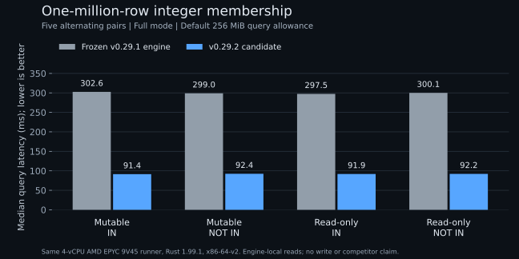

# v0.29.2 release preflight

The release candidate contains bounded integer membership compilation and
cached inline-scan metadata from
[`c319423`](https://github.com/ZVN-DEV/powdb/commit/c319423f1a36186589a91e6dad59fa0ffd297fc3).
The measured engine passes fresh performance, correctness and packaging
preflights. Subsequent changes are documentation and the addon runner update;
the engine sources, package manifests and lockfiles match the measured
`e1928ca1aa4f440db63d37ccb338b96b4e993d73` candidate. Final merge still requires
`ci-success` on the exact PR head. Publishing and live registry availability
are verified separately from these preflight results.

## Review scope

The membership compiler runs only after the established predicate compiler
declines. Its hybrid state is bounded to 32 leaves and 128 original entries per
list. Unsupported expressions retain their existing path. Null semantics,
overflow guards, cancellation, literal binding, and mutable/read-only execution
must remain equivalent to generic evaluation. SQL `IN` remains unsupported.

Inline scans reuse the existing immutable `RowLayout`. The decoder still checks
the complete metadata span, including the terminal variable offset when there
are no variable columns. Review includes legacy/v1 malformed-input outcomes,
overflow/v2 fallback, and cached-layout refresh after schema changes and reopen.
The change adds no public API, stored-format, default-durability or memory-limit
change.

## Fresh acceptance gates

- [x] [Required Linux/macOS CI](https://github.com/ZVN-DEV/powdb/actions/runs/42324540069)
  on the measured source: compatibility, Miri, ASan and corpus replay. The
  [final PR checks](https://github.com/ZVN-DEV/powdb/pull/274/checks) also gate merge.
- [x] [All 22 absolute and 22 paired Criterion checks and four ratio checks](https://github.com/ZVN-DEV/powdb/actions/runs/42324568990),
  using the released `v0.29.1` as the same-instance control.
- [x] [Five alternating membership pairs](https://github.com/ZVN-DEV/powdb/actions/runs/42324571444)
  at 100K and 1M rows, both operators
  and both execution surfaces, against the frozen pre-optimization engine.
- [x] [Extended fuzz campaign and deterministic recovery corpus](https://github.com/ZVN-DEV/powdb/actions/runs/42324573594).
- [x] [Patch API compatibility and dry-run packaging of all eight Rust crates](https://github.com/ZVN-DEV/powdb/actions/runs/42324575466).
- [x] [Three-platform embedded addon build, tests and package dry run](https://github.com/ZVN-DEV/powdb/actions/runs/42325582701).
- [x] Local full quality and package checks on a disk-backed temporary path:
  formatting, strict Clippy, workspace and documentation tests, TypeScript pure
  and server-backed suites, package/import smoke. Optional cargo-audit and
  gitleaks executables are unavailable locally; both corresponding CI jobs pass.

The first addon dry run's two Linux builds passed, but GitHub refused to start
the macOS 14 job with `macos-14-arm64-us-default is not supported`.
The addon workflow now uses `macos-latest`, matching the binary release workflow.
The complete corrected dry run passes all three builds and the bundled-package
validation. An intervening dispatch of the old revision was cancelled after
its runner configuration was superseded.

## Broad regression gate

The candidate is compared with the actual published v0.29.1 commit
`266feca22f791503df5d4b6a1c727b36e2bd0f21`, on the same runner with matching
compiler and flags. All existing absolute, same-instance and ratio gates pass.
The measured engine code and fixtures retain every original threshold.

Selected same-instance median observations include both slower and faster
workloads:

| Workload | Control | Candidate | Change |
| --- | --- | --- | --- |
| Raw scan/filter | 3.634 ms | 3.619 ms | -0.43% |
| Point query | 1.231 us | 1.233 us | +0.11% |
| Filter/projection | 4.995 ms | 5.084 ms | +1.77% |
| Integer AVG | 521.090 us | 545.775 us | +4.74% |
| Integer MIN | 395.514 us | 408.011 us | +3.16% |
| Integer MAX | 396.540 us | 405.261 us | +2.20% |
| Sort/limit | 2.143 ms | 2.057 ms | -3.98% |
| Indexed update | 1.708 us | 1.618 us | -5.28% |
| Batch insert, 1K | 245.696 us | 247.369 us | +0.68% |

[All retained Criterion estimates and the gate verdict](2026-11-06-v0.29.2-criterion.json)
cover every workload, including those omitted from this table. Large absolute
differences from the older static baseline are not credited as code-only gains.
The legacy suite uses WAL Off and does not establish durable-write throughput;
the native membership experiment below measures a different, scoped workload.

## Membership measurements

All eight cases pass the unchanged 2x minimum improvement gate, with successful
exact counts for all 80 control/candidate samples. These are medians of five
alternating pairs on the same four-vCPU AMD EPYC 9V45 VM, Rust 1.99.1,
`-C target-cpu=x86-64-v2`, Full mode and the default 256 MiB query allowance.
The frozen control is `8508546560f7a280792d6ba37058f71f98e85e53`;
the measured candidate is `e1928ca1aa4f440db63d37ccb338b96b4e993d73`.

| Rows | Surface | Filter | Control median | Candidate median | Ratio |
| --- | --- | --- | --- | --- | --- |
| 100K | Mutable | IN | 27.466 ms | 6.732 ms | 4.080x |
| 100K | Mutable | NOT IN | 27.106 ms | 6.592 ms | 4.112x |
| 100K | Read-only | IN | 28.345 ms | 7.311 ms | 3.877x |
| 100K | Read-only | NOT IN | 27.877 ms | 7.754 ms | 3.595x |
| 1M | Mutable | IN | 302.648 ms | 91.437 ms | 3.310x |
| 1M | Mutable | NOT IN | 298.966 ms | 92.429 ms | 3.235x |
| 1M | Read-only | IN | 297.481 ms | 91.906 ms | 3.237x |
| 1M | Read-only | NOT IN | 300.096 ms | 92.197 ms | 3.255x |

[Raw samples and computed medians](2026-11-06-v0.29.2-membership.json) and
[machine, compiler and binary provenance](2026-11-06-v0.29.2-membership-provenance.txt)
are retained with the report. The lower ratios than the earlier PR's run belong
to a different host and build; older results are not substituted for this run.

The first local full sweep used this host's RAM-backed `/tmp` and failed the
concurrent group-commit scheduling assertion: all 160 commits received their
own fsync in each of five attempts. The durability checks passed. The complete
group-commit suite passes with a disk-backed temporary directory, where fsync
can overlap with producers. The full local sweep passes on that disk-backed
path; no test assertion or engine behavior is changed.

## Measurement limits

These native engine checks do not establish competitor rankings, ORM or
serverless performance, peak RSS bounds, or durable-write throughput. Membership
timings use Full mode and the existing 256 MiB memory allowance; the legacy
Criterion suite uses WAL Off. Unindexed queries still visit their input rows.

The earlier identical-source A/A diagnostic
[`41978054224`](https://github.com/ZVN-DEV/powdb/actions/runs/41978054224)
reported a 12.61% single-insert difference. That is a measurement/build
stability concern, not permission to waive a failing release gate. Earlier
failed runs remain part of the review record in
[PR 271](https://github.com/ZVN-DEV/powdb/pull/271).

No benchmark threshold, baseline, fixture, safety guard, durability setting or
memory limit is relaxed for this release. New public claims require retained
raw samples and provenance. Historical SQLite lookup/update ratios remain
withdrawn pending controlled remeasurement.

Publishing and live registry verification follow successful preflight. Install
pins and the current-release stamp remain on the verified published version
until all six published-install checks pass.
