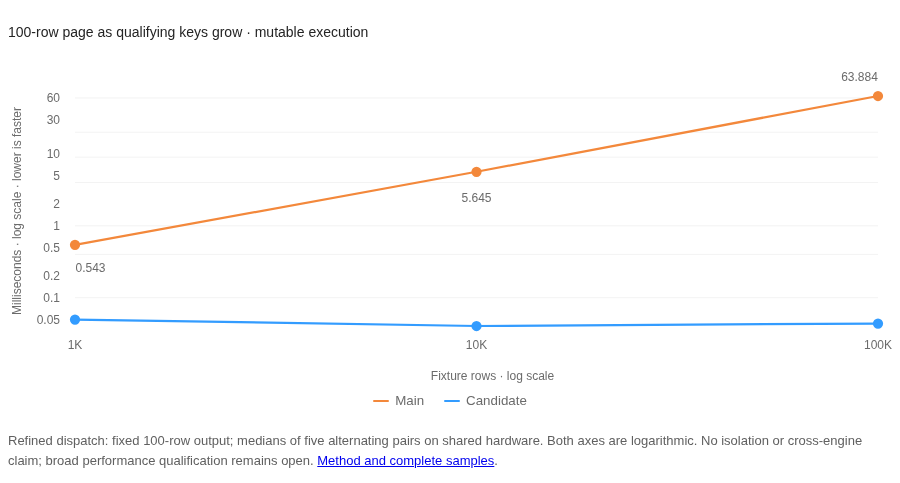

# Bounded index-page diagnostic: 2026-11-08

An ascending page over a matching unique integer index now stops at its requested rows. The prior path collected all matching index keys, fetched their rows and sorted them before applying the limit. This diagnostic measures that mechanism against unchanged main, not an overall database ranking or an isolated-host speed claim.

The refined build passes all 22 local regression checks and the existing ratio checks after dispatch integration was narrowed. This workstation run is explicitly non-authoritative because it differs from the recorded hosted environment. Current-head CI and hosted performance qualification remain pending; the initial failed run is retained below.

## Scope

```powql
Page filter .id >= 0 order .id limit 100 { .id, .payload }
```

The initial optimization handles one ascending unique integer key, a literal limit, and an optional plain-field projection. Numeric bounds may be inclusive, exclusive or one-sided. Unfiltered keys must be required because unique indexes omit nulls. Offsets, residual predicates, other orders/types and missing/non-unique indexes retain their existing paths. Computed projections remain in the normal projection evaluator, whose bounded ordered input may independently qualify.

The storage visitor borrows keys, seeks to the lower bound and stops without allocating a full match list. It checks cancellation on every tree node, including empty leaves. Table row fetches reconstruct overflow values. Query memory admission charges fetched/projected rows as they are produced; the result is still materialized, not a streaming cursor.

## Provenance and method

- Control production code: `a3a83225653d42e73a1ee1ba2b620769f832245b` (main).
- Candidate production code: `e5fba68d4a4ab211eac6a0c2847410db47a0615e`; the same diagnostic driver is added to the control tooling only.
- Separate build directories, optimized default-feature builds, no test instrumentation; Rust 1.99.1 and no rustflags override.
- Shared developer workstation: AMD RYZEN AI MAX+ 395 w/ Radeon 8060S. Each measured process was pinned to CPU 8; no core reservation, desktop shutdown or exclusive hardware was used.
- Five alternating control/candidate pairs. Each binary loads fresh 1K/10K/100K fixtures, checkpoints them, warms each case three times, then records seven calls per case/surface. Both binaries are built before measurement.
- Each result is checked for columns, all 100 ordered IDs and every payload. Summary cells are medians of five per-run medians. Timed execution includes result materialization; verification is outside timing.
- `all_qualify` starts at zero; `last_100` seeks to the final 100 keys. Output cardinality is fixed. No competing database or durable write is timed.

## Observations



All values are microseconds. These are local diagnostic medians; shared-host variance remains visible in the raw samples.

| Fixture rows | Surface | All qualify: control | All qualify: candidate | Last 100: control | Last 100: candidate |
| --- | --- | ---: | ---: | ---: | ---: |
| 1,000 | Mutable | 543.097 | 49.613 | 63.298 | 55.885 |
| 1,000 | Read-only | 541.855 | 50.966 | 60.844 | 57.497 |
| 10,000 | Mutable | 5,645.287 | 40.396 | 59.702 | 56.857 |
| 10,000 | Read-only | 5,529.280 | 50.645 | 59.832 | 57.959 |
| 100,000 | Mutable | 63,884.098 | 43.742 | 61.294 | 81.422 |
| 100,000 | Read-only | 60,525.015 | 63.990 | 59.973 | 83.676 |

The candidate removes growth with qualifying range cardinality in this fixed-output probe. Cases that already qualified only 100 keys stay in roughly the same latency range; the samples do not establish a consistent improvement for those cases. This does not establish scaling beyond the recorded fixtures, behavior under concurrent writers, or superiority to another database.

Raw observations, binary hashes, host/compiler details and pair order: [refined JSON evidence](2026-11-08-index-pages-refined.json). SHA-256: `eeea99bb6ec572bdee105d3243c2b8b4c2a673966d6d3b094a98bdeee26ae92a`. The [initial page measurements](2026-11-08-index-pages.json) remain retained at their original source revision.

## Broad performance qualification

The initial full local run failed six same-instance workload checks and one ratio ceiling. [Full original estimates and failure table](2026-11-08-index-pages-broad-initial.json) are retained. The environment guard first refused comparison against the hosted baseline; its explicit diagnostic override was then used. That run is not authoritative and does not qualify performance.

[Serial main/candidate/main controls](2026-11-08-index-pages-focused-controls.json) reproduced three unrelated fast-path slowdowns in the initial version. The refinement confines index-page probing to potentially eligible sort/limit branches instead of probing every dispatched plan. [Fresh serial controls](2026-11-08-index-pages-refined-controls.json) put all six originally flagged workloads within their unchanged thresholds against both surrounding main runs. Main-to-main drift nevertheless exceeded 10% in two controls, so those timings remain diagnostic. The [complete refined local run](2026-11-08-index-pages-broad-refined.json) then passed all 22 regression checks and all ratio checks under the comparator's explicit non-authoritative environment override. The original environment refusal is not bypassed by spoofing runner/flag values: recorded flags remain empty. The [fresh hosted gate](https://github.com/ZVN-DEV/powdb/actions/runs/42556288532) must still be reviewed before shipping; no baseline or threshold is changed.

## Correctness and verification

- Tests prove a 17-row eligible page delivers 17 index entries and attempts 17 heap fetches on mutable and read-only execution, with no sequential row visits. Counters are absent from default production builds.
- Fast/forced-generic parity covers inclusive/exclusive bounds, empty and reversed ranges, integer extremes, nullable keys, aliased output columns, overflow rows, deletes/key updates, restart, zero/huge limits, and unsupported shapes.
- Low-budget tests accept small pages and reject large pages with typed memory-limit errors. Cancellation tests stop during traversal and across empty leaves.
- The existing cross-product access-path equivalence corpus includes the new path. The full local quality sweep passes (workspace tests/doc tests, strict Clippy, TypeScript live tests and package/import smokes); cargo-audit and gitleaks are unavailable locally and remain CI checks.
- Regression tests also cover a pre-existing projection/limit literal-cache ordering bug discovered during parity checks. Ambiguous cache shapes now replan.
- The full local quality sweep also passes for the dispatch refinement. `cargo run --release -p powdb-compare --bin compare-engines` completed as a contributor check; its legacy summary is not used to establish rankings here. Local regression checks now pass; current-head CI and hosted qualification remain open as described above.

## Reproduce

```bash
cargo run --release -p powdb-bench --bin index-page-probe > index-pages.json
# Optional: POWDB_INDEX_PAGE_SIZES=1000,10000,100000
cargo test -p powdb-query --test bounded_index_page --test plan_cache_literal_order
cargo test -p powdb-query --test access_path_equivalence
cargo test -p powdb-query --lib bounded_index_page
cargo test -p powdb-storage --lib visitor_
```

Use separate build directories for control/candidate binaries. Record source revisions, flags and binary hashes; retain samples rather than selecting the fastest run.
