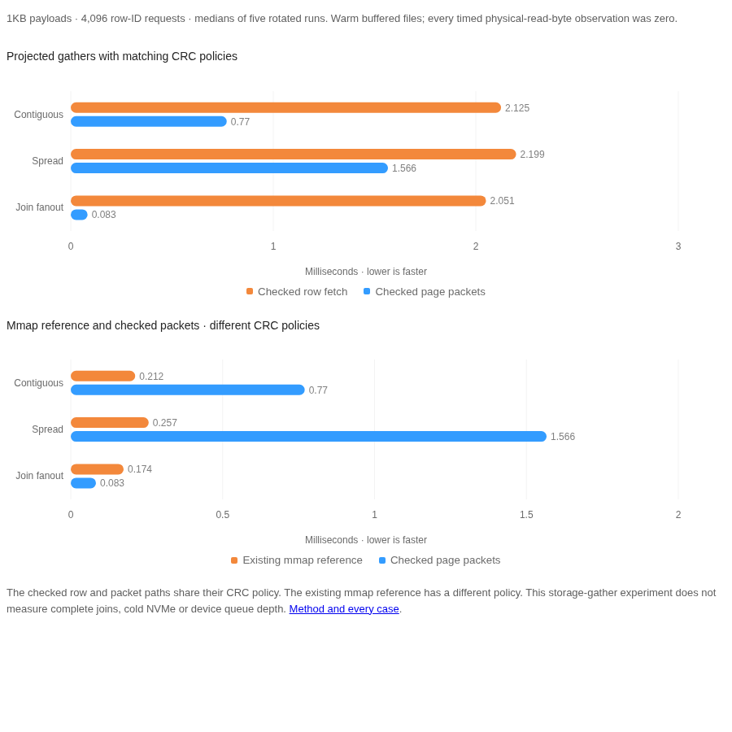

# Projected page-gather experiment: 2026-11-08

Grouping repeated row-ID requests by physical page can reduce redundant primary-page reads and decoding. This non-shipping probe measures a quiescent storage gather, not a complete join or a production access path. Every timed result is checked for exact values, missing slots, requested order and duplicate multiplicity. All timed physical-read-byte observations are zero: these are warmed buffered-file observations, not NVMe device-speed evidence.

## Method

- Source: `903a993bcc6bb9ca141d753bef8d9a75edfc6710`; production engine code matches main merge 1d03ddffaf74f781d51c93a3777bd26bb9c0f4af.
- Rust rustc 1.99.1 (58cf8f9c3 2026-10-13); optimized default-feature build with no rustflags override; binary SHA-256 `1daf6dc92a3b7693717f83809085f211a921cc4a437acd4c1b69040d763b0825`.
- Shared AMD RYZEN AI MAX+ 395 w/ Radeon 8060S workstation, CPU 8 affinity, Btrfs disk-backed fixtures. No exclusive-core or device-isolation claim.
- Five serial process runs. Strategy order rotates by run, fixture and case. Each variant has two warmups and seven measured calls per run. The table is the median of five per-run medians. All 1,260 timed calls verify their full result.
- Each fixture has 8,192 rows and independently generated deterministic ASCII payloads of 64, 1,024 or 8,192 bytes. One row is deleted before checkpoint. Checkpoint/reopen clears trusted hot/dirty buffers before comparing checked file reads.
- Each trace has 4,096 requests: contiguous rows, shuffled spread, or shuffled repeated requests to rows in the first 16 primary data pages. Trace construction models already-produced row IDs and is outside timing. Sorting, packet planning, output allocation and order restoration are inside timing.
- Linux `/proc/self/io` read-byte differences are captured around every timed call. No global cache eviction is performed; the fixtures are deliberately warmed.
- The packet path projects only the fixture's non-spilled integer id. General overflow-column projection, active transactions, dirty-page overlays, cancellation and concurrent mutations are outside this prototype.

## Integrity and comparison boundaries

`full_row_checked` and `projected_row_checked` use the engine accessors with mmap disabled. `projected_page_packet_checked` reads each requested existing primary page once, uses the same validate-if-present CRC and row-format rules, decodes each distinct live requested slot once and scatters results back to logical order. Unit tests cover duplicate/missing/deleted rows, nonexistent pages, invalid slots, empty requests, inline/overflow fixtures and primary-page corruption refusal.

`projected_mmap_reference` uses the engine's existing mmap policy, which omits per-read page CRC. It is a separate reference with a different integrity policy. The two projected checked paths are the matching-policy comparison. A packet can never be promoted by silently selecting a weaker integrity policy.

## Results



All latency values are microseconds; lower is faster. These diagnostic observations have no aggregate score or cross-engine ranking.

| Payload bytes | Request trace | Full row, checked | Projected row, checked | Packet, checked | Projected mmap reference | Distinct primary pages |
| --- | --- | ---: | ---: | ---: | ---: | ---: |
| 64 | contiguous | 2,025.745 | 1,895.812 | 116.528 | 107.130 | 92 |
| 64 | spread | 2,130.823 | 2,004.415 | 202.649 | 107.752 | 183 |
| 64 | join_fanout | 2,093.602 | 1,968.468 | 86.582 | 104.887 | 16 |
| 1,024 | contiguous | 3,286.277 | 2,124.811 | 770.203 | 212.128 | 1,366 |
| 1,024 | spread | 3,510.197 | 2,199.190 | 1,566.354 | 256.571 | 2,388 |
| 1,024 | join_fanout | 3,122.690 | 2,050.542 | 82.996 | 174.016 | 16 |
| 8,192 | contiguous | 21,615.778 | 1,957.537 | 107.151 | 106.580 | 51 |
| 8,192 | spread | 22,394.808 | 2,081.039 | 176.951 | 105.808 | 102 |
| 8,192 | join_fanout | 20,031.069 | 1,975.631 | 92.584 | 103.254 | 16 |

On the 1,024-byte fanout trace, the packet performs 16 explicit primary-page fetches and decodes 47 distinct live rows for 4,096 logical requests. Order restoration retains duplicates and the deleted-row results. Full-row fetches additionally decode payload bytes that this projection never uses.

The packet is not a universal warmed-path improvement. Its 1,024-byte spread case is slower than the mmap reference; sorting and buffered per-page requests can dominate when locality or duplicate reuse is limited. These results support measuring conditional access strategies, not replacing mmap unconditionally.

No asynchronous read queue, extent coalescing, relationship index or complete join execution is implemented here. Reductions in explicit page requests are not reductions in physical device reads in this warmed profile. Actual NVMe claims require separately observed device I/O, queue-depth/request-size experiments and useful tail-latency/cancellation behavior.

Raw observations, every per-run median, physical-read counters, exact workload sizes and provenance: [JSON evidence](2026-11-08-page-gather.json). SHA-256 `f9a1ea0b9a89a84fd32ee5dec16cd8b2e102dc058d0702d3876b7fbb9c703463`.

## Reproduce

```bash
cargo test -p powdb-bench --bin page-gather-probe
TMPDIR=/path/on/ssd cargo run --release -p powdb-bench --bin page-gather-probe > page-gather.json
# Optional: POWDB_GATHER_ROWS, POWDB_GATHER_REQUESTS, POWDB_GATHER_SAMPLES,
# POWDB_GATHER_PAYLOADS (comma-separated byte widths), POWDB_GATHER_ORDER
```

The complete local quality sweep passes (workspace/doc tests, strict Clippy, TypeScript live tests and package/import smokes). Cargo-audit and gitleaks are unavailable locally and remain CI checks. Production code, formats and benchmark thresholds are not changed by this tooling experiment.
