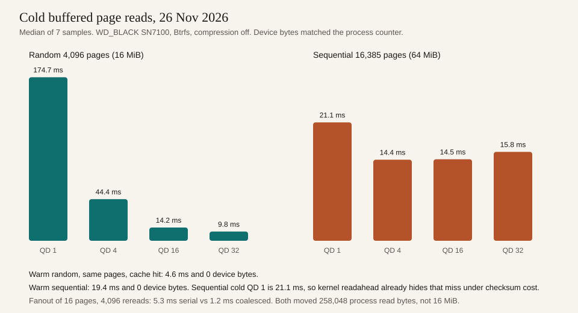

# Cold buffered page reads: 2026-11-26

Evicting this heap from the page cache makes the next `pread` show up as real NVMe traffic. On random 4 KiB pages, raising queue depth from 1 to 32 cut median latency from 174.7 ms to 9.8 ms while device bytes stayed near the logical read. On a sequential 64 MiB read, kernel readahead already hid the miss: cold queue depth 1 was 21.1 ms against a warm checksum pass at 19.4 ms. Grouping a 16-page fanout did not reduce device bytes versus rereading those pages, because the cache absorbed the duplicates, and it did cut median latency from 5.3 ms to 1.2 ms.

This is a non-shipping probe. Production reads are unchanged. The file is smaller than RAM. The enforced budget is "this file is not resident," applied with `posix_fadvise(POSIX_FADV_DONTNEED)` before every cold sample. Nothing here is an `io_uring`, `O_DIRECT`, or larger-than-RAM result.



## What changed since 9 November

Nothing on `origin/main` after the 8 November page-gather merge. `origin/main` is still `239e1c8`. That tree matches `bench/page-packet-gather`. The cold measurement had not been run. The 8 November evidence still has 1,260 warm samples at 0 physical-read bytes.

## Method

- Branch `bench/cold-page-reads`, parent `531b24b`, same tree as `origin/main` (`aee1f777232d`). The probe is local and uncommitted.
- Binary SHA-256 `d104d040db072177de9a92395c1c969d2389e000104c85af9705aee0613dcd98`. Rust rustc 1.99.1. Release build, no rustflags override.
- AMD RYZEN AI MAX+ 395, 125 GiB RAM, shared workstation. No core reservation. Fixture on Btrfs over `nvme1n1` (WD_BLACK SN7100 4TB) through `/dev/mapper/root`.
- `btrfs property set <fixture> compression none` before the load. Mount default is zstd, which otherwise shrinks device bytes far below the logical pages.
- 16,384 rows, 2,048 incompressible payload bytes, checkpoint, then close the engine. Heap is 16,385 pages, 67,112,960 bytes. `HeapFile::open` is not used after that. Its free-space scan would read every page and warm the cache before the timer.
- Each fetch is `DiskManager::read_page` (`pread`) plus `Page::from_bytes_verified`. Queue depth is N threads issuing those reads. The engine has no `io_uring` and no `O_DIRECT`.
- Seven samples. A fingerprint of every verified page must match. `/proc/self/io` `read_bytes` is the physical counter. `nvme1n1` sectors from `/proc/diskstats` are corroboration on a shared machine.
- Warm controls run after a full read and before any eviction. Every warm sample moved 0 process bytes and 0 `nvme1n1` bytes.

## Results

Milliseconds, median of seven. Lower is faster. Device bytes are the median of `/proc/self/io` `read_bytes` for that case. On every sample except the short fanout packet, that counter matched `nvme1n1` exactly.

| Case | Queue depth | Cold | Median ms | Min ms | Max ms | Logical bytes | Device bytes |
| --- | ---: | --- | ---: | ---: | ---: | ---: | ---: |
| Sequential, all 16,385 pages | 1 | no | 19.43 | 19.35 | 19.53 | 67,112,960 | 0 |
| Random, 4,096 pages | 1 | no | 4.65 | 4.17 | 4.87 | 16,777,216 | 0 |
| Sequential, all pages | 1 | yes | 21.08 | 20.24 | 21.66 | 67,112,960 | 67,112,960 |
| Sequential, all pages | 4 | yes | 14.43 | 13.97 | 14.87 | 67,112,960 | 67,112,960 |
| Sequential, all pages | 16 | yes | 14.51 | 13.17 | 16.56 | 67,112,960 | 67,112,960 |
| Sequential, all pages | 32 | yes | 15.82 | 14.91 | 17.25 | 67,112,960 | 67,112,960 |
| Random, 4,096 pages | 1 | yes | 174.65 | 173.49 | 176.86 | 16,777,216 | 17,952,768 |
| Random, 4,096 pages | 4 | yes | 44.43 | 42.57 | 45.24 | 16,777,216 | 17,948,672 |
| Random, 4,096 pages | 16 | yes | 14.17 | 13.90 | 14.42 | 16,777,216 | 17,932,288 |
| Random, 4,096 pages | 32 | yes | 9.81 | 9.64 | 10.69 | 16,777,216 | 17,911,808 |
| Fanout, 4,096 rereads of 16 pages | 1 | yes | 5.28 | 4.75 | 5.59 | 16,777,216 | 258,048 |
| Fanout packet, those 16 pages once | 1 | yes | 1.22 | 0.28 | 1.32 | 65,536 | 258,048 |

Random cold throughput at the median, including checksum work: about 23,500 pages/s at queue depth 1, 92,200 at 4, 289,000 at 16, and 418,000 at 32. Device bytes stayed about 7% above the 16 MiB logical read.

The fanout packet's process counter was 258,048 on every sample. The `nvme1n1` counter moved, but not by the same amount, on that roughly 1 ms window. The longer cases matched the process counter on all seven samples. Seven samples make the JSON `p95` the slowest sample. The table reports min, median, and max instead.

## What this does and does not say

Sequential cold traffic is real: every sample moved exactly 67,112,960 bytes, the whole file. It is not where scheduling wins. Warm checksum of the same file is already 19.4 ms, and cold queue depth 1 is 21.1 ms. Queue depth 4 finishing in 14.4 ms, faster than the single-threaded warm pass, means those threads are also splitting the CRC work. That is not a pure device-queue result.

Random reads are the device result. Queue depth 1 spends about 170 ms beyond the 4.6 ms warm CPU pass. Queue depth 32 brings the same read to 9.8 ms. That gap is larger than checksum parallelism can explain, and the device bytes stay near one pass over the 4,096 pages.

Rereading 16 hot pages 4,096 times does not multiply device bytes. Both the serial reread and the one-pass packet moved 258,048 process bytes, about 63 pages rather than 16, which is readahead around a tight cluster. The packet is faster because it issues 16 reads instead of 4,096 and verifies each page once.

No asynchronous engine queue, extent coalescing, relationship index, or join execution was added. A file larger than 125 GiB was not built. `O_DIRECT` was not used. Global `drop_caches` was not used. It needs root, and this process does not have it.

## Reproduce

```bash
TMPDIR=/path/on/btrfs cargo test -p powdb-bench --bin cold-page-probe
TMPDIR=/path/on/btrfs cargo run --release -p powdb-bench --bin cold-page-probe > cold-page-reads.json
# Optional: POWDB_COLD_ROWS, POWDB_COLD_PAYLOAD, POWDB_COLD_SAMPLES,
# POWDB_COLD_RANDOM_PAGES, POWDB_COLD_FANOUT, POWDB_COLD_DEPTHS
```

`/tmp` on this machine is tmpfs. The probe refuses a tmpfs fixture. Raw samples and provenance: [JSON evidence](2026-11-26-cold-page-reads.json). SHA-256 `77ad2876a8105dc926cca8017ca1cf5f4691312bf1591ecced3eafcc63a3c9ef`.
